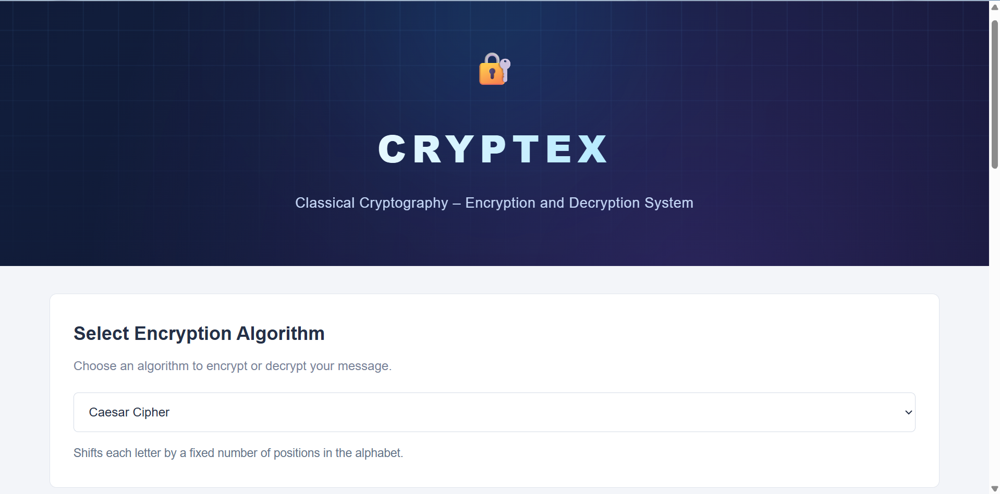
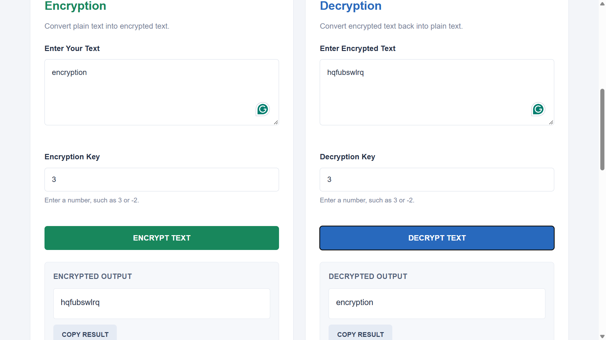
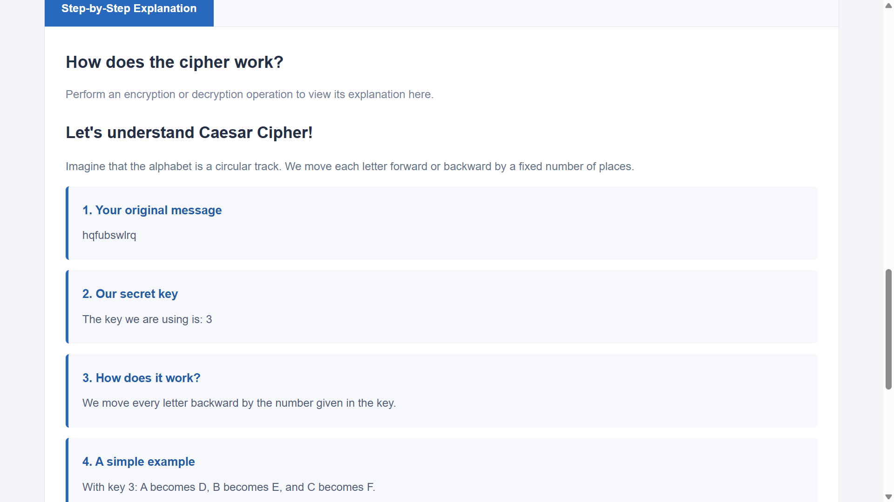
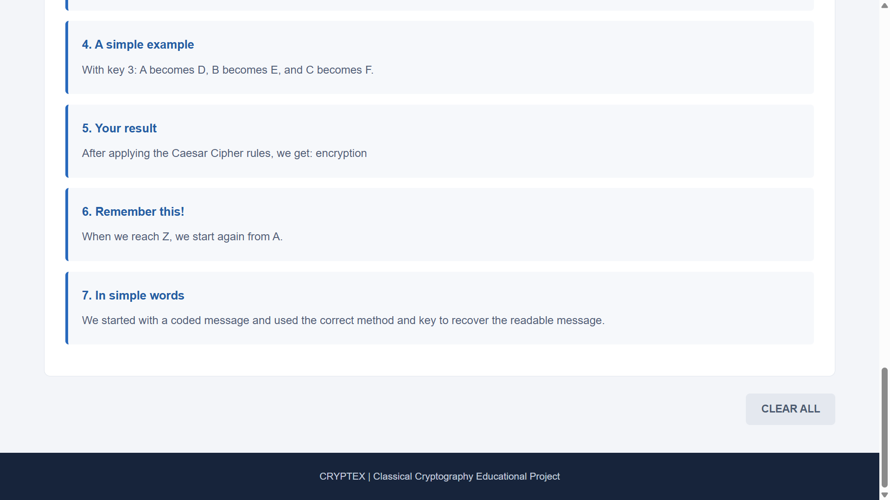

### **CRYPTEX | Classical Cryptography**

An interactive web application for exploring classical encryption and decryption techniques.

#### **Overview**

CRYPTEX is a browser-based cryptography project that demonstrates seven classical cipher techniques through an interactive interface. It allows users to encrypt and decrypt messages by selecting an algorithm and providing the required key.

The project aims to make traditional cryptographic methods easier to explore and understand through practical demonstrations.

#### **Supported Cipher Algorithms**

Caesar Cipher-Shifts letters by a specified number of positions.

Atbash Cipher-Reverses the alphabet substitution.

Vigenère Cipher-Uses a keyword for polyalphabetic substitution.

Rail Fence Cipher-Rearranges text using a zigzag pattern.

ROT13 Cipher-Applies a fixed shift of 13 positions.

Monoalphabetic Substitution-Uses a fixed substitution alphabet.

Columnar Transposition-Rearranges characters using a column-based pattern.

#### **Features**

•	Seven classical encryption and decryption methods.

•	Interactive cipher selection.

•	Separate encryption and decryption sections.

•	Key-based encryption for supported algorithms.

•	Input validation.

•	Copy functionality for generated results.

•	Algorithm descriptions and working explanations.

•	Simple and user-friendly interface.

#### **Technologies**

•	HTML5 – Structure and content.

•	CSS3 – Styling and interface design.

•	JavaScript – Cipher algorithms and application functionality.

#### **Project Structure**

CRYPTEX/

│

├── index.html              # Main webpage

├── style.css                # Styling and layout

├── script.js                 # Cipher logic and functionality

└── README.md       # Project documentation

#### **Getting Started**

###### **Run Locally**

1\.	Clone the repository: git clone https://github.com/riya-fathima-u/CRYPTEX.git

2\.	Open the downloaded project folder.

3\.	Open index.html in your web browser.

4\.	Start exploring the available cipher methods.

#### **How to Use**

1\.	Select a cipher algorithm from the available options.

2\.	Enter the message you want to process.

3\.	Provide the required key, if applicable.

4\.	Click the Encrypt button to generate the encrypted text.

5\.	To reverse the process, enter the encrypted text and the corresponding key in the decryption section.

6\.	Use the copy option to copy the generated output.

#### **Learning Objective**

This project was developed to explore the fundamentals of classical cryptography and understand how different substitution and transposition techniques transform messages.

#### **Limitations**

Classical ciphers are historically important but are not secure by modern cryptographic standards. CRYPTEX is intended for educational and experimental use only and should not be used to protect confidential information.

#### **Author**

Developed as a personal learning project in web development and classical cryptography.

#### **Live Demo**

Visit CRYPTEX: [https://riya-fathima-u.github.io/CRYPTEX/](https://riya-fathima-u.github.io/CRYPTEX/)

#### **Screenshots**

###### **Homepage**

\

###### **Encryption and Decryption Interface**

\

###### **Step-by-Step Explanation**

\
\

